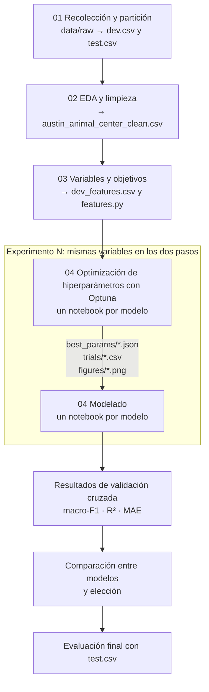
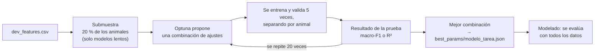

# mucsi-ml-animal-shelter-project

Proyecto de aprendizaje supervisado de Machine Learning, MUCSI Deusto 2026-27.

**Equipo:** Katherine Lorenzo, Mauro Cornejo, Jorge Vargas

A partir de los datos de ingreso de un animal en el Austin Animal Center, predecir:

| Tarea | Objetivo |
|---|---|
| Clasificación | Resultado de salida (`outcome_type`, multiclase: `Adoption` (incluye `Rto-Adopt`), `Transfer`, `Return to Owner`, `Euthanasia` y `Other`) |
| Regresión | Días hasta la adopción (`time_in_shelter_days`, evaluado exclusivamente sobre registros adoptados) |

Datos: [Austin Animal Center Shelter Intakes and Outcomes (Kaggle)](https://www.kaggle.com/datasets/aaronschlegel/austin-animal-center-shelter-intakes-and-outcomes), en `data/raw/aac_intakes_outcomes.csv`.

## Estructura

```
data/
  raw/          dataset original
  interim/      particiones dev y test (notebook 01)
  processed/    datos limpios (notebook 02)
notebooks/
  config.py     semilla común
  features.py   variables nuevas y preprocesador (notebook 03)
  tuning.py     búsqueda de hiperparámetros con Optuna (notebooks 04)
  01-data-collection-split-and-quality.ipynb
  02-eda-and-cleaning.ipynb
  03-feature-engineering-and-transformation.ipynb
  04-hyperparameter-optimization-experiment-1/   un notebook por modelo, más best_params/, trials/ y figures/
  04-modeling-experiment-1/                      un notebook por modelo
```

| Notebook | Entrada | Salida |
|---|---|---|
| 01 Recolección y calidad del dato | `data/raw/` | `data/interim/dev.csv`, `data/interim/test.csv` |
| 02 EDA y limpieza | `data/interim/dev.csv` | `data/processed/` |
| 03 Ingeniería de características y transformación | `data/processed/` | `data/processed/dev_features.csv` y `build_preprocessor` (en `notebooks/features.py`) |

## Experimentos (paso 04)

Un **experimento** es un conjunto de variables de entrada con dos pasos: primero se buscan los mejores ajustes (hiperparámetros) de cada modelo y después se evalúa cada modelo con esos ajustes. Los dos pasos usan las mismas variables, por eso comparten el número de experimento.



Cómo se busca y se evalúa un modelo:



La búsqueda da una sola combinación por modelo, tarea y experimento. Cada archivo y cada gráfica que genera está explicado en [`README.md`](notebooks/04-hyperparameter-optimization-experiment-1/README.md).

| Si cambia... | Qué hacer |
|---|---|
| Las variables de entrada o el objetivo | Crear un experimento nuevo (por ejemplo el 2): repetir la optimización y el modelado. El experimento 1 se deja intacto para comparar. |
| `dev_features.csv`, por ejemplo al ejecutar el notebook 03 con cambios | Repetir la optimización y el modelado. El notebook de modelado se detiene con un aviso si no se hizo. |
| Solo la evaluación, por ejemplo una métrica | Repetir solo el modelado. |

Todos los modelos usan la misma validación (5 grupos separados por animal), la misma semilla y el mismo número de pruebas, para que se puedan comparar.

## Setup

**Windows**

```bash
python -m venv .venv
.venv\Scripts\activate
pip install -r requirements.txt
```

**macOS**

```bash
python3 -m venv .venv
source .venv/bin/activate
pip install -r requirements.txt
```

Seleccionar `.venv` como kernel y ejecutar el notebook 01 para generar `data/interim/`.

## Reglas de trabajo

- En la medida de lo posible, cada persona edita solo su notebook para evitar conflictos.
- `SEED` se importa de `notebooks/config.py` (`from config import SEED`).
- `test.csv` no se explora, solo se usa en la evaluación final.
- `data/interim/` y `data/processed/` no se suben, se generan con los notebooks.
- Antes de cada commit, reiniciar el kernel y ejecutar todo.
