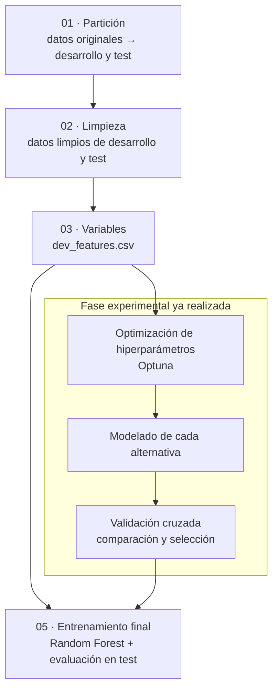

# Guía de ejecución del proyecto

## 1. Introducción

Proyecto de aprendizaje supervisado de Machine Learning de **MUCSI Deusto 2026-27**, desarrollado por **Katherine Lorenzo, Mauro Cornejo y Jorge Vargas**.

Utiliza datos de ingresos y salidas del Austin Animal Center para resolver dos tareas:

- **Clasificación:** predecir el resultado de salida del animal (`outcome_type`).
- **Regresión:** estimar los días que un animal adoptado pasa en el refugio (`time_in_shelter_days`).

Repositorio original en GitHub: [mucsi-ml-animal-shelter-project](https://github.com/JorgeAVargasC/mucsi-ml-animal-shelter-project).

Esta guía explica dónde están los archivos principales y cómo reproducir el flujo final. El modelo elegido para esa ejecución es **Random Forest**, tanto para clasificación como para regresión.

El dataset original puede obtenerse de [Austin Animal Center Shelter Intakes and Outcomes](https://www.kaggle.com/datasets/aaronschlegel/austin-animal-center-shelter-intakes-and-outcomes) y debe estar en `data/raw/aac_intakes_outcomes.csv`.

## 2. Cómo está organizado el repositorio

- [`data/raw/`](data/raw/): dataset original de Austin Animal Center.
- [`data/interim/`](data/interim/): particiones de desarrollo y test que genera el notebook 01.
- [`data/processed/`](data/processed/): datos limpios del notebook 02 y variables preparadas por el notebook 03.
- [`notebooks/`](notebooks/): flujo de preparación y entrenamiento, experimentos comparativos y funciones compartidas (`features.py`, `tuning.py` y `config.py`).
- [`results/`](results/): documentación de la validación cruzada y la evaluación final, además de los modelos serializados.

Los archivos de `data/interim/` y `data/processed/` están excluidos de Git. Se crean al ejecutar los notebooks, por lo que no se debe esperar que estén presentes en una copia limpia del repositorio.

## 3. Qué se probó y por qué se eligió Random Forest

Durante el proyecto se compararon varios modelos mediante validación cruzada. Se hicieron dos experimentos de optimización y evaluación; sus resultados completos se resumen en [`results/cross-validation-results.md`](results/cross-validation-results.md).

Random Forest fue el mejor modelo en clasificación en ambos experimentos. En el experimento 1 obtuvo macro-F1 **0,576**, frente a **0,566** en el experimento 2. En regresión, el experimento 2 obtuvo un R² en log algo mayor (**0,431** frente a **0,413**), pero el experimento 1 tuvo un MAE ligeramente menor (**18,556** frente a **18,615 días**). Para mantener la misma configuración de variables en las dos tareas, el modelo final utiliza Random Forest con los ajustes del experimento 1.

En la búsqueda de hiperparámetros de Random Forest se probaron 20 configuraciones con Optuna y una muestra del 20 % de los animales. La comparación de modelos usa validación cruzada de cinco grupos, separados por animal. Los notebooks están en las carpetas de [optimización del experimento 1](notebooks/04-hyperparameter-optimization-experiment-1/) y [experimento 2](notebooks/04-hyperparameter-optimization-experiment-2/), y de [modelado del experimento 1](notebooks/04-modeling-experiment-1/) y [experimento 2](notebooks/04-modeling-experiment-2/). Este trabajo forma parte del desarrollo, pero **no es necesario volver a ejecutar esos experimentos** para reproducir el pipeline final: los parámetros de Random Forest del experimento 1 ya están guardados y el notebook final los carga.

El siguiente esquema distingue el flujo de preparación, la fase experimental y la ejecución final. La fase experimental ya se realizó; para reproducir el resultado final se ejecutan los pasos 01, 02, 03 y 05.



En el flujo final, el paso 05 usa la configuración seleccionada y guardada; no vuelve a ejecutar las búsquedas ni los notebooks de modelado experimental.

## 4. Preparar el entorno

Se necesita Python y las dependencias indicadas en [`requirements.txt`](requirements.txt). Desde la raíz del repositorio, crea y activa el entorno virtual e instala los paquetes.

**Windows (PowerShell):**

```powershell
python -m venv .venv
.\.venv\Scripts\Activate.ps1
pip install -r requirements.txt
```

**macOS / Linux:**

```bash
python3 -m venv .venv
source .venv/bin/activate
pip install -r requirements.txt
```

Después, abre los notebooks en un entorno compatible con Jupyter y selecciona `.venv` como kernel. Los notebooks utilizan rutas relativas a la carpeta `notebooks/`; ejecútalos desde el propio notebook y en el orden indicado abajo.

Antes de empezar, comprueba que está disponible `data/raw/aac_intakes_outcomes.csv`. Si no está, descarga el dataset de Austin Animal Center enlazado en la introducción y coloca el archivo en esa ruta. Las carpetas de datos intermedios y procesados se generan durante la ejecución.

## 5. Ejecutar el pipeline final

Ejecuta todas las celdas de cada notebook, de principio a fin, en este orden. No ejecutes los notebooks de modelado u optimización del paso 04 para obtener el resultado final.

| Orden | Notebook | Qué hace y qué produce |
|---|---|---|
| 1 | [`01-data-collection-split-and-quality.ipynb`](notebooks/01-data-collection-split-and-quality.ipynb) | Lee el CSV original y separa los animales en desarrollo y test (80/20), agrupando por identificador para que el mismo animal no aparezca en ambos conjuntos. Genera `data/interim/dev.csv` y `data/interim/test.csv`. |
| 2 | [`02-eda-and-cleaning.ipynb`](notebooks/02-eda-and-cleaning.ipynb) | Limpia los datos de desarrollo y aplica los mismos pasos de limpieza a test, sin explorarlo. Genera `data/processed/austin_animal_center_clean.csv` y `data/processed/austin_animal_center_clean_test.csv`. |
| 3 | [`03-feature-engineering-and-transformation.ipynb`](notebooks/03-feature-engineering-and-transformation.ipynb) | Crea variables a partir de la información disponible al ingreso y prepara los objetivos de clasificación y regresión. Guarda `data/processed/dev_features.csv`. La definición compartida de las variables y del preprocesador está en [`features.py`](notebooks/features.py). |
| 4 | [`05-final-training-and-test.ipynb`](notebooks/05-final-training-and-test.ipynb) | Carga las variables de desarrollo y el test limpio, reconstruye las variables de test con las mismas funciones, carga los parámetros `rf_clf` y `rf_reg` del experimento 1, entrena ambos Random Forest con todo el conjunto de desarrollo y 200 árboles por modelo, y evalúa test una sola vez. Guarda `results/models/model_clf.joblib` y `results/models/model_reg.joblib`. |

El notebook 05 requiere los archivos [`rf_clf.json`](notebooks/04-hyperparameter-optimization-experiment-1/best_params/rf_clf.json) y [`rf_reg.json`](notebooks/04-hyperparameter-optimization-experiment-1/best_params/rf_reg.json) de [`best_params/`](notebooks/04-hyperparameter-optimization-experiment-1/best_params/). En este repositorio están guardados; por eso no hay que volver a ejecutar Optuna. Si se modifican los datos o las variables, los parámetros podrían dejar de corresponder a la búsqueda documentada.


## 6. Resultados esperados y comprobación

Al completar el notebook 05, se muestran las métricas de clasificación y regresión y se guardan los dos modelos en `results/models/`. Las métricas también están resumidas en [`results/test-final-results.md`](results/test-final-results.md); no se genera en este flujo un archivo de métricas independiente.

Los valores documentados en test son:

- **Clasificación:** macro-F1 **0,578**.
- **Regresión:** R² **0,412** (calculado sobre el logaritmo de los días) y MAE **18,393 días**.

La regresión se evalúa únicamente sobre animales adoptados. El MAE se expresa en días; el R² se calcula sobre el objetivo transformado a logaritmo. Para comprobar que la ejecución terminó correctamente, confirma que el notebook muestra métricas para ambas tareas y que se han creado `model_clf.joblib` y `model_reg.joblib` en `results/models/`. Los resultados deben ser coherentes con los valores anteriores; las versiones de las dependencias y los datos pueden afectar a una reproducción.

## 7. Documentación Anexa

- [Resultados de validación cruzada](results/cross-validation-results.md)
- [Resultados finales en test](results/test-final-results.md)
- Notebooks de [optimización del experimento 1](notebooks/04-hyperparameter-optimization-experiment-1/) y [experimento 2](notebooks/04-hyperparameter-optimization-experiment-2/)
- Notebooks de [modelado del experimento 1](notebooks/04-modeling-experiment-1/) y [experimento 2](notebooks/04-modeling-experiment-2/)
- [Random Forest: modelado del experimento 1](notebooks/04-modeling-experiment-1/04.1-random-forest.ipynb)
- [Random Forest: modelado del experimento 2](notebooks/04-modeling-experiment-2/04.2-random-forest.ipynb)
- [Funciones de variables y preprocesamiento](notebooks/features.py)
- [Búsqueda y carga de hiperparámetros](notebooks/tuning.py)
