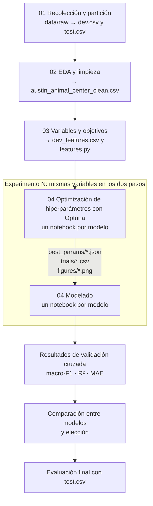
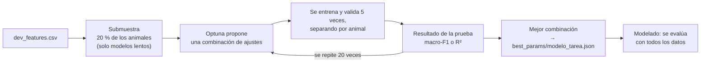

# mucsi-ml-animal-shelter-project

Proyecto de aprendizaje supervisado de Machine Learning, MUCSI Deusto 2026-27.

**Equipo:** Katherine Lorenzo, Mauro Cornejo, Jorge Vargas

A partir de los datos de ingreso de un animal en el Austin Animal Center, predecir:

| Tarea | Objetivo |
|---|---|
| Clasificación | Resultado de salida (`outcome_type`, multiclase: `Adoption` (incluye `Rto-Adopt`), `Transfer`, `Return to Owner`, `Euthanasia` y `Other`) |
| Regresión | Días hasta la adopción (`time_in_shelter_days`, evaluado exclusivamente sobre registros adoptados) |

Datos: [Austin Animal Center Shelter Intakes and Outcomes (Kaggle)](https://www.kaggle.com/datasets/aaronschlegel/austin-animal-center-shelter-intakes-and-outcomes), en `data/raw/aac_intakes_outcomes.csv`.

## Estructura

```
data/
  raw/          dataset original
  interim/      particiones dev y test (notebook 01)
  processed/    datos limpios de dev y de test (notebook 02) y variables de dev (03)
results/
  cross-validation-results.md resumen de la validación cruzada de todos los modelos
  test-final-results.md       resultados finales del modelo elegido en test
  models/       modelos finales (notebook 05)
notebooks/
  config.py     semilla común
  features.py   variables nuevas y preprocesador (notebook 03)
  tuning.py     búsqueda de hiperparámetros con Optuna (notebooks 04)
  01-data-collection-split-and-quality.ipynb
  02-eda-and-cleaning.ipynb
  03-feature-engineering-and-transformation.ipynb
  04-hyperparameter-optimization-experiment-1/   un notebook por modelo, más best_params/, trials/ y figures/
  04-modeling-experiment-1/                      un notebook por modelo
  04-hyperparameter-optimization-experiment-2/   experimento 2 (por ahora SVM y KNN)
  04-modeling-experiment-2/
  05-final-training-and-test.ipynb
```

| Notebook | Entrada | Salida |
|---|---|---|
| 01 Recolección y calidad del dato | `data/raw/` | `data/interim/dev.csv`, `data/interim/test.csv` |
| 02 EDA y limpieza | `data/interim/dev.csv` y `test.csv` | `data/processed/austin_animal_center_clean.csv` y `austin_animal_center_clean_test.csv` |
| 03 Ingeniería de características y transformación | `data/processed/` | `data/processed/dev_features.csv` y `build_preprocessor` (en `notebooks/features.py`) |
| 05 Entrenamiento final y evaluación en test | `dev_features.csv`, `austin_animal_center_clean_test.csv` y `best_params/` del experimento 1 | `results/models/` |

## Resultados

La comparación de todos los modelos en validación cruzada está en [`results/cross-validation-results.md`](results/cross-validation-results.md) y los resultados finales en test en [`results/test-final-results.md`](results/test-final-results.md). El **random forest** es el mejor en clasificación y en regresión, en los dos experimentos.

Modelo final: random forest con la configuración del experimento 1 en las dos tareas, entrenado con todo dev y evaluado una sola vez en test (notebook 05). Los hiperparámetros son los de la búsqueda del experimento 1, con `n_estimators=200` como en la validación. Limitación: la búsqueda se hizo con el 20 % de los animales.

## Experimentos (paso 04)

Un **experimento** es un conjunto de variables de entrada con dos pasos: primero se buscan los mejores ajustes (hiperparámetros) de cada modelo y después se evalúa cada modelo con esos ajustes. Los dos pasos usan las mismas variables, por eso comparten el número de experimento.



Cómo se busca y se evalúa un modelo:



La búsqueda da una sola combinación por modelo, tarea y experimento. Cada archivo y cada gráfica que genera está explicado en [`README.md`](notebooks/04-hyperparameter-optimization-experiment-1/README.md).

| Si cambia... | Qué hacer |
|---|---|
| Las variables de entrada o el objetivo | Crear un experimento nuevo (por ejemplo el 2): repetir la optimización y el modelado. El experimento 1 se deja intacto para comparar. |
| `dev_features.csv`, por ejemplo al ejecutar el notebook 03 con cambios | Repetir la optimización y el modelado. |
| Solo la evaluación, por ejemplo una métrica | Repetir solo el modelado. |

Todos los modelos usan la misma validación (5 grupos separados por animal), la misma semilla y el mismo número de pruebas, para que se puedan comparar.

| Experimento | Variables | Modelos |
|---|---|---|
| 1 | Variables del notebook 03. SVM y KNN sin raza, color ni ciudad | SVM, KNN |
| 2 | Experimento 1 más raza, color y ciudad, y edad en logaritmo en regresión | SVM, KNN |

## Setup

**Windows**

```bash
python -m venv .venv
.venv\Scripts\activate
pip install -r requirements.txt
```

**macOS**

```bash
python3 -m venv .venv
source .venv/bin/activate
pip install -r requirements.txt
```

Seleccionar `.venv` como kernel y ejecutar el notebook 01 para generar `data/interim/`.

## Reglas de trabajo

- En la medida de lo posible, cada persona edita solo su notebook para evitar conflictos.
- `SEED` se importa de `notebooks/config.py` (`from config import SEED`).
- `test.csv` no se explora: el notebook 02 solo lo limpia y el 05 lo evalúa una sola vez.
- `data/interim/` y `data/processed/` no se suben, se generan con los notebooks. Los modelos de `results/models/` sí se suben, comprimidos para que cada archivo pese menos de 100 MB.
- Orden de ejecución: 01, 02, 03, 04 (el experimento que se use) y 05.
- Antes de cada commit, reiniciar el kernel y ejecutar todo.
